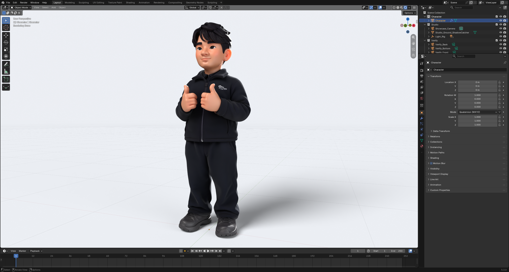

# AI-generated 3D character: preservation package

A stylised 3D character of Sun Haosong, made from a photo with AI tools and refined in Blender.
Archived for AIP2005 Lab Assessment 1 (Digital Object Preservation), University of Malaya.



## How it was made

1. A photo of the author on stage at the 2026 AI for Future Talent final (kept offline for privacy).
2. GPT Image 2.6 turned the photo into a cartoon six-view character sheet: `sources/reference_views/`.
3. Tencent Hunyuan 3D 3.0 (TokenHub API, model `hy-3d-3.0`, PBR on, 250,000 faces) built a textured
   mesh from the front, back, left and right views on 18 November 2026: `sources/tencent_output/`.
4. In Blender 5.3, with Claude (AI assistant), the mesh was scaled to 1.40 m, its material refined and
   a studio light rig added: `master/character_hunyuan3d_studio.blend`.

## How to open it

| File | Open with | Notes |
|---|---|---|
| `master/character_hunyuan3d_studio.blend` | Blender 5.3 or newer | The master. Saved by 5.3.0, uncompressed; the three 4096 px textures are packed inside, so no other files are needed. Press F12 to render with Cycles from `Showcase_Camera`. |
| `derivatives/hunyuan3d_v3_multiview_textured_with_metadata.glb` | Any glTF 2.0 viewer | Open-standard copy of the generated model (ISO/IEC 12113:2022) with embedded metadata. Use it if Blender is unavailable. |
| `derivatives/final_showcase_1080p.png` | Any image viewer | Reference render of the intended look. |

## Folders

| Folder | Contents |
|---|---|
| `master/` | The preserved Blender file. Never edit it in place: save new versions alongside it. |
| `sources/reference_views/` | The cartoon views sent to Tencent (front, back, left, right) and the full six-view sheet. |
| `sources/tencent_output/` | Tencent's original GLB, OBJ package, preview, the job request and its response (signed download links removed). |
| `derivatives/` | GLB copy with metadata, final render, Blender screenshot. |
| `metadata/` | Sidecar metadata record for the GLB and a full inventory of the .blend (`blend_inventory.json`). |
| `scripts/` | The scripts used to request, inspect, describe and save the files. No API key is stored anywhere. |

## Metadata

- **In the .blend:** custom properties on the Scene and on the `Character` object (Object Properties >
  Custom Properties): author, copyright, title, description, workflow, source model and its SHA-256,
  repository.
- **In the GLB copy:** `asset.copyright` and a Dublin Core packet in the `KHR_xmp_json_ld` extension.
- **Sidecar files:** `metadata/*.json`.

## Fixity

`MANIFEST-SHA256.txt` lists a SHA-256 checksum for every file. To check them:

```
sha256sum -c MANIFEST-SHA256.txt
```

`.gitattributes` stops Git from changing line endings, so the checksums stay valid after cloning.

## Rights

Copyright 2026 SUN HAOSONG. All rights reserved. The character depicts the author. The model was
generated with Tencent Hunyuan 3D; the service's terms of use have not yet been reviewed.
